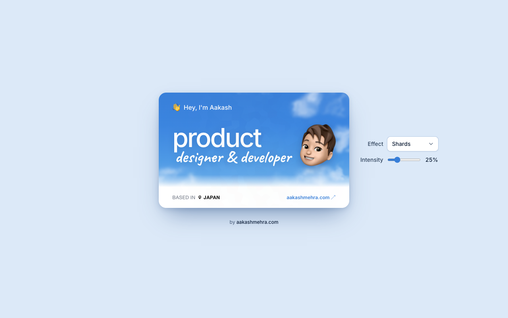
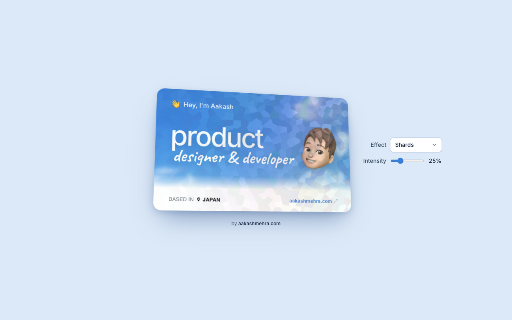
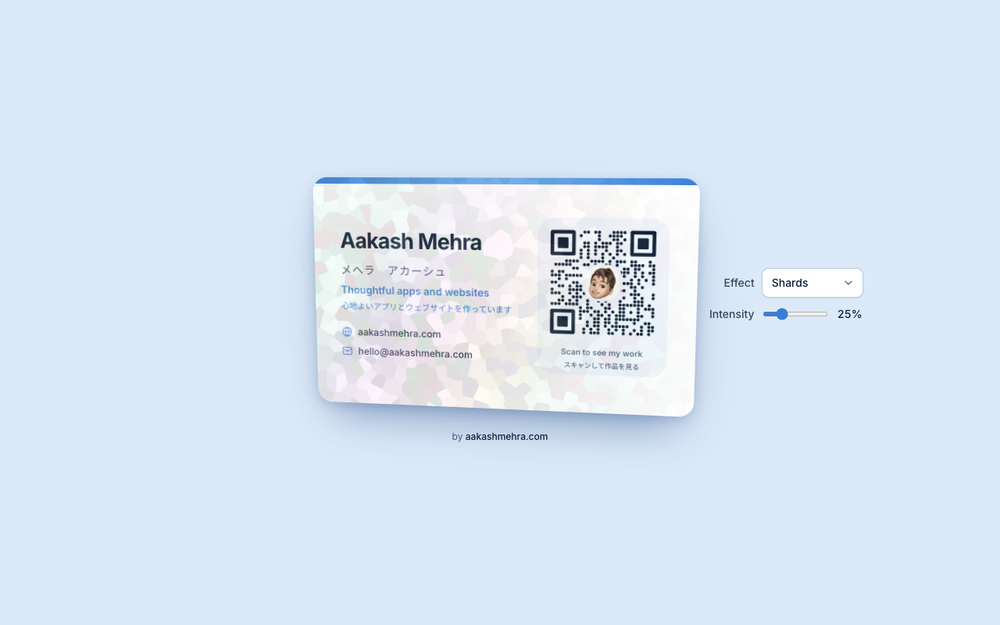

# Holographic Business Card

An interactive business card with holographic foils, by [Aakash Mehra](https://aakashmehra.com).



The card tilts toward your pointer, scales up slightly on hover, and flips on click to show the back. Pick a foil from the Effect menu and set its strength with the Intensity slider. The QR code stays scannable with every effect.

| Hovered (Shards) | Back |
| --- | --- |
|  |  |

Effects: Shards (default), Rainbow, Stars, Cosmos, Hearts, Shapes, Gold, Silver and Aurora. All of them are plain CSS gradients, masks and blend modes, so they work in Safari on iPhone too.

## Run

```bash
npm install
npm run dev
```

Open http://localhost:3000.

## Files

- `components/ui/business-card.tsx`: the card, with `effect` and `intensity` props.
- `components/ui/card-effects.ts`: the effect list and styles.
- `components/ui/demo.tsx`: the demo page with the Effect and Intensity controls.

Built with Next.js, TypeScript, Tailwind CSS v4, shadcn/ui and Motion.
